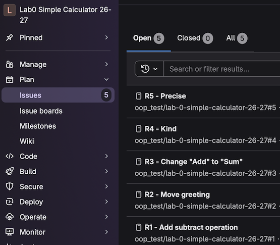
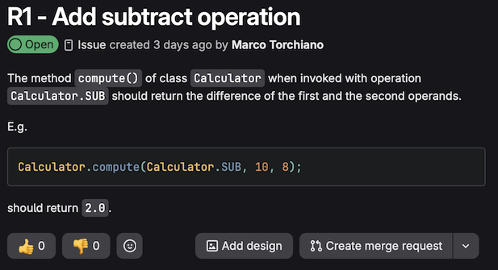
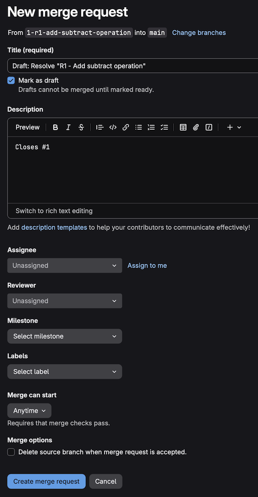
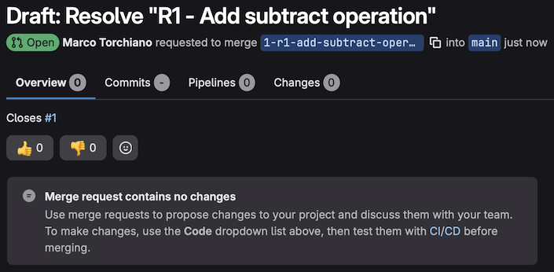
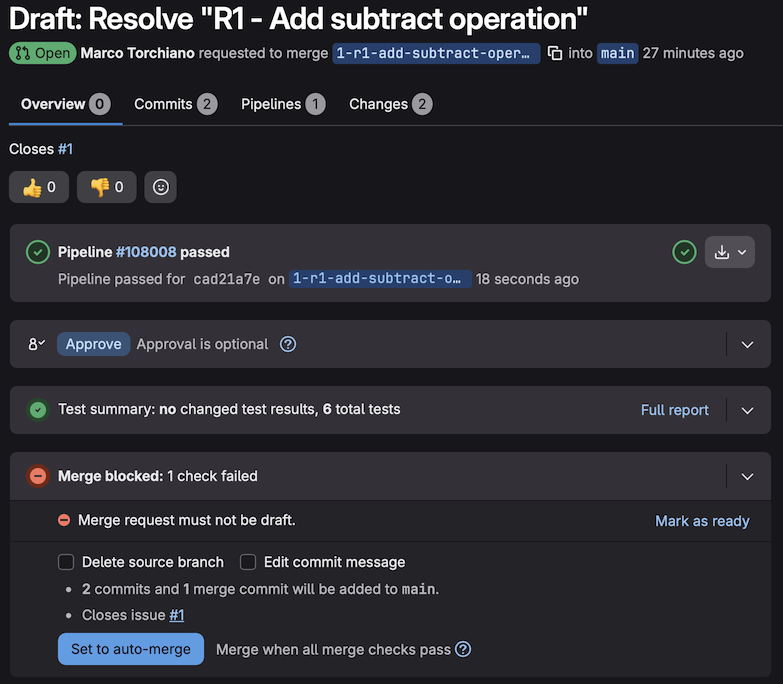
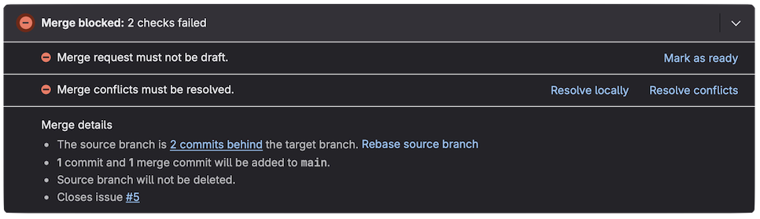
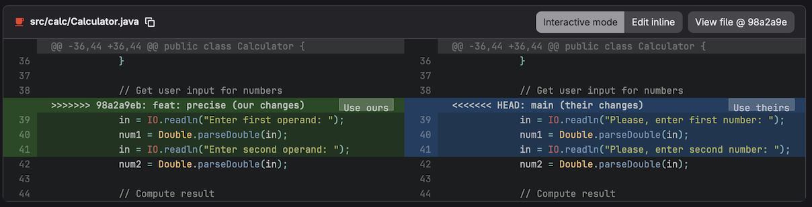
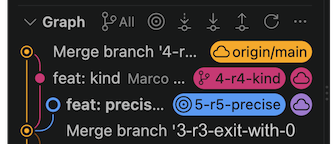
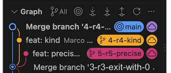
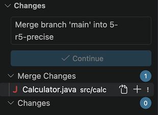

# Lab0 - Simple Calculator

The goal of this lab assignment is to learn usage of *git* operations and the *gitflow* procedure.

All *git* operations described here can be performed either using the graphical UI or using the Command Line Interface (CLI) provided by a terminal.

### 1. Clone a repository using VSCode and git.

-  On GitLab click the blue "`Code`" button and then "`Clone with HTTPS`" &#x1F4CB; to copy the link to the repository
    - if you are using VSCode installed on your computer you can click on `Visual Studio Code (HTTPS)`
-  In VSCode clone the repository:
    - In the welcome screen select "`Clone Git Repository...`"  
    or  
    [`Ctrl`] [&#x21e7;] [`P`] or [&#x2318;] [&#x21e7;] [`P`] to show the command palette, then write *Clone* and select *Git: Clone*
    - Enter the url of this repository, the one copied from GitLab in previous step
    - Select a location on the file system
        - in Crownlabs use `/vscode/workspace` which is preserved in case of crash
    - Enter your username (e.g., s999999) and password
    - Confirm that you want to open the project


### 2. Create a Merge Request with relative branch for R1

 In GitLab, starting from an Issue, create a new Merge Request and the relative Feature Branch:

- In the left menu, select *Plan > Work Items*  to show the issue list

    

- Open the issue #1 *"R1 - Add subtract operation"* which is the one at the bottom (they are in inverse order of creation)

    

- Click on '*Create merge request*' button to create a draft merge request with the default settings

    - when asked, keep the default name for the branch (`1-r1-add-subract-operation`)

    

- Check details and confirm creation of MR
    - make sure `Mark as draft` is checked
    - you can add info to the description (keep the default part since it links to the Issue)
    - assign the issue (for one person projects click on `Assign to me`)
    - make sure `Delete source branch...` is **NOT** checked
    - click on `Create merge request`

    

    The result is a draft Merge Request associated with a new branch in the repo


### 3. Implement the code to complete the MR

-  In VSCode, before the development can take place, the local repository must be updated with a *Fetch*

    - Click  on the git actions bar:

    

    - or in Source Control panel `...` > `Pull, Push` > `Fetch`

        - &#x276F;_ `git fetch`

-  Switch to the feature branch `1-r1-add-subtract-operation`

    - click on the branch button in the bottom bar 

        or

    - in the Source Control tab, `...` > `Checkout to...`  


    - then pick the feature branch from the list of available branches `origin/1-r1-add-subtract-operation`.
        - &#x276F;_ `git switch 1-r1-add-subtract-operation`

    All development **MUST** be performed in the feature branch non in the `main` branch!

-  In VSCode complete the code for the application
    - It must perform basic arithmetic operations: addition, subtraction, multiplication, and division
    - Most the code is already present in `Calculator.java`, the subtraction operation is missing

-  In VSCode, click on the Test button on the left 
    - Expand the contents until you find `TestCalculator.java`
    - Click on the run button &#x23F5; next to the file
    - If any test fails a red circled &#10006; appears, read the message and fix the program.
      (the first time it will fail since the subtraction code is missing)
    - If tests succeed a green circled &#10004; appears next to the tests

&#9888;&#65039; Proceed only if all tests pass.


### 4. Commit and Push all the files to the remote repository

&#9888;&#65039; If you **never used git** on you computer, or you already used git but with another server, before proceeding you also need to set the [author info](#author-info).

-  In VSCode commit and push your code
    - Click the Source Control button  to open the Source Control panel
    - You will see the changes, including `Calculator.java` with an **M** on its right meaning that it has been **M**odified
    - You can click on `Calculator.java` to show the differences
    - Add `Calculator.java` to the "Staged Changes" by clicking on the **`+`** next to it
        - &#x276F;_   `git add src/calc/Calculator.java`
    - Enter the commit message (e.g. "First Requirement") and click the "Commit" button
        - &#x276F;_   `git commit --message "First Version"`
        - &#9888;&#65039; if you **forget to enter the message** an editor is opened where you can enter the messagge, save it and click che checkmark at top right to proceed
    - Click in the `Sync Changes` button to push the changes to the remote repository
        - &#x276F;_   `git push`

-  On GitLab the web page of the Merge Request should show the new commit as well as the result of the tests.

    

### 5. Merge the Merge Request


-  On GitLab proceed with the Merge Request
    - Check the pipeline pass (green checkmark), otherwise fix it in VS Code and push fixed version
    - Mark the MR as ready by clicking on the link `Mark as ready`, this makes the `Merge` button appear

    - Make sure to NOT check the option *Delete source branch* 
    - Click on `Merge`.


As a result a new merge commit is added to the target (`main`) branch and both the Merge Request is  and the associated Issue is closed.

### 6. Work on two parallel feature branches

-  In GitLab, create a Merge Request for both issues R2 and R3

    - Issue #2 *R2 - Move greeting*
    - Issue #3 *R3 - Exit with 0*

    Create two relative Merge Requests

-  implement R2
    - Fetch all remote branches

    - Switch to the feature branch `2-r2-move-greeting` 
    - Apply the requested change, i.e. move the greeting as required by [R2](#r2---move-greeting)
    - Run the tests
    - Commit and push your code

-  implement R3
    - Switch to the feature branch `3-r3-exit-with-0` 
    - Make the requested change, i.e. use `0` to exit as required by [R3](#r3---exit-with-0)
    - Run the tests
    - Commit and push your code

-  In GitLab, merge the first MR:

    - From the left menu *Code* > *Merge Requests* and select MR *Resolve "R2 - Move greeting"*
    - Check it passes all the tests
    - Mark it as ready
    - Click on `Merge`

-  In GitLab, merge the second MR:

    - From the left menu *Code* > *Merge Requests* and select MR *Resolve "R3 - Exit with 0"*
    - Check it passes all the tests
    - Mark it as ready
    - Click on `Merge`

&#x1F4AC; Since the two branches modified separate lines (even though in the same file) they can be merged without problem, in any order.

### 6. Work on two parallel conflicting branches

We simulate what happens when two developers make (conflicting) changes at the same time (on the same section of a file).

-  In GitLab, create a Merge Request for both issues R4 and R5

    - Issue #4 *R4 - Kind*
    - Issue #5 *R5 - Precise*

    - Create a Merge Request for both

-  In VSCode, Implement the requirement R4
    - Fetch all remote branches
    - Switch to the feature branch `4-r4-kind`
    - Make the requested change, i.e., add a "Please" as required by [R4](#r4---kind)
    - Run the tests
    - Commit and push your code
-  In VSCode, Implement the requirement R5
    - Switch to the feature branch `5-r5-precise`
    - Make the requested change, i.e., use the term "operand" as required by [R5](#r5---precise)
    - Run the tests
    - Commit and push your code

-  In GitLab, merge the first MR:

    - From the left menu *Code* > *Merge Requests* and select MR *Resolve "R4 - Kind"*
    - Check it passes all the tests
    - Mark it as ready
    - Click on `Merge`

-  In GitLab, observe the conflict that now appears for the second MR:

    - From the left menu *Code* > *Merge Requests* and select MR *Resolve "R5 - Precise"*
    
        

    - Click on the *Resolve Conflicts* link to see how to resolve it online in GitLab:

        

      &#x1F4AC; For very simple conflicts, this is a quick and easy way to resolve them.
      The problem is that there is not syntax check and no possibility to run tests before committing the changes.

      &#9888;&#65039; DO NOT RESOLVE THIS CONFLICT ONLINE

    - Click `Cancel` to return to the main MR page.

-  In VSCode, resolve the conflict by combining the two changes.

    - Fetch all remote changes

        - &#x276F;_  `git fetch`

        We observe the pointer to the remote main (`origin/main`) is updated, although the local `main` branch is not.

        

    - Switch to main and pull to have local `main` branch up to date

        - &#x276F;_  `git switch main`
        - &#x276F;_  `git pull`

        

    - Switch back to branch `5-r5-precise`
        - &#x276F;_  `git switch 5-r5-precise`

    - Merge `main` into `5-r5-precise`
        - `...` > `Branch` > `Merge...` and then select `main`
            - &#x276F;_  `git merge main`

            The conflicting file is shown in the *Merged Changes* section of the Source Control panel

            

            The conflict is also visible in the editor, surrounded by `<<<<<<< HEAD` and `>>>>>>> main`:

            ```java
            <<<<<<< HEAD (Current Change)
                in = IO.readln("Enter first operand: ");
                num1 = Double.parseDouble(in);
                in = IO.readln("Enter second operand: ");
            =======
                in = IO.readln("Please, enter first number: ");
                num1 = Double.parseDouble(in);
                in = IO.readln("Please, enter second number: ");
            >>>>>>> main (Incoming Change)        
            ```

    - Resolve the conflict in the editor
        - In this specific case the easiest way is to modify one of the two alternative (*Current Change* or *Incoming Change*) incorporating the changes from the other and then accept it

            E.g.

            ```java
            <<<<<<< HEAD (Current Change)
                in = IO.readln("Please, enter first operand: ");
                num1 = Double.parseDouble(in);
                in = IO.readln("Please, enter second operand: ");
            =======
                in = IO.readln("Please, enter first number: ");
                num1 = Double.parseDouble(in);
                in = IO.readln("Please, enter second number: ");
            >>>>>>> main (Incoming Change)        
            ```

            And then click `Accept Current Change`

    - Confirm the conflict has been resolved
        - Click on the `+` right of the `Calculator.java` file in the Source Control panel to add it to the Staged Changes

        - &#x276F;_  `git add src/calc/Calculator.java`

    - Continue merge and push

        - Click on `Continue` and then on `Sync Changes` or Push

        - &#x276F;_  `git merge --continue`
        - &#x276F;_  `git push`

-  In GitLab, observe the conflict is resolve and procees with the merge
    - Check it passes all the tests
    - Mark it as ready
    - Click on `Merge`


---

# Settings

## Author info

When performin a commit, git automatically adds information about the author of the commit.

The possible cases are:

- you never used git on you computer, the first commit fails because it needs the name and email of the author of the commit.

    To solve this problem you need to open a terminal and write the following commands:

    ```sh
    git config --global user.email "s999999@studenti.polito.it"
    git config --global user.name "Your Name"
    ```

    The above operation needs to be performed only once on the computer.

- you already used git with your personal account (e.g. GitHub) then that account is used automatically.

    You can overwrite the account as shown above.

    Otherwise you can set an account for the project only:

    ```sh
    git config user.email "s999999@studenti.polito.it"
    git config user.name "Your Name"
    ```

For more infor see: [Git Config reference](https://git-scm.com/docs/git-config#OPTIONS).


---

# Requirements

The following requirements are present as Issues in the repository.

## R1 - Add subtract operation

The method `compute()` of class `Calculator` when invoked with operation `Calculator.SUB` should return the difference of the first and the second operands.

E.g.
```java
Calculator.compute(Calculator.SUB, 10, 8);
```

should return `2.0`.


## R2 - Move greeting

Move the greetings print before the command loop so that the message `"\nSimple Calculator"` is printed only once when app starts and not before every command.


## R3 - Exit with 0

Change the exit code value to `0`.

Change the code and the relative prompt.


## R4 - Kind

Prefix the request for a new number with a `"Please"`

Change the two `"Enter first number"` and `"Enter second number"` into `"Please, enter first number"` and `"Please, enter second number"`.


## R5 - Precise

Replace the request for a `number` with a request for an `operand`.

Change the two `"Enter first number"` and `"Enter second number"` into `"Enter first operand"` and `"Enter second operand"`.


---
V 3.0.0.
